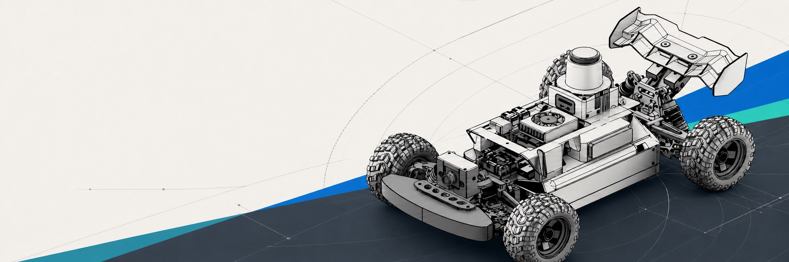

# OSRacer Base

<!-- markdownlint-disable MD013 MD033 -->

<p align="center">
  <a href="./README.md">English</a> ·
  <a href="./README_zh.md">简体中文</a>
</p>

<p align="center">
  
</p>

<p align="center">
  <strong>ROS 2 motion control and state sensing for intelligent vehicle applications.</strong>
</p>

<p align="center">
  <a href="https://github.com/osrbot/osracer_base/actions/workflows/ros2-ci.yml"></a>
  <a href="https://docs.ros.org/en/humble/"></a>
  <a href="https://docs.ros.org/en/jazzy/"></a>
  <a href="./LICENSE"></a>
</p>

Standard ROS 2 interfaces connect vehicle control and state sensing to path tracking,
localization, navigation, and autonomous driving applications.

## Core Capabilities

### Unified Motion Control

Send velocity and Ackermann steering commands without handling serial communication directly.

### Synchronized State Sensing

Synchronized motion and inertial data share timestamps for localization and state estimation.

### Connection Management and Runtime Protection

Connection checks, automatic reconnection, invalid-data filtering, and command-timeout stop requests.

### Standard ROS 2 Integration

Standard topics, configurable coordinate frames, and an RViz entry point.

## Runtime Environment

| Operating system | ROS 2 distribution |
| --- | --- |
| Ubuntu 22.04 | Humble |
| Ubuntu 24.04 | Jazzy |

Install the corresponding ROS 2 environment first. Commands use Bash; `rosdep`
installs Python, ROS message, and serial dependencies.

## Quick Start

Install the build tools and load ROS. Replace `humble` with `jazzy` for Jazzy:

```bash
source /opt/ros/humble/setup.bash
sudo apt update
sudo apt install git python3-rosdep python3-colcon-common-extensions python3-pytest
```

Run `sudo rosdep init` on first use only.

```bash
rosdep update
mkdir -p ~/osracer_base_ws/src
cd ~/osracer_base_ws/src
git clone https://github.com/osrbot/osracer_base.git
```

Use the driver version supplied with your vehicle. Before upgrading, contact [technical support](mailto:winter@osrbot.com) to confirm compatibility.

```bash
cd ~/osracer_base_ws
rosdep install --from-paths src --ignore-src --rosdistro "$ROS_DISTRO" -r -y
colcon build --packages-select osracer_base --symlink-install
source install/setup.bash
ros2 pkg prefix osracer_base
```

Confirm the package path is under this workspace's `install` directory. Load the
environment in each new terminal, substituting your workspace path if needed:

```bash
source /opt/ros/humble/setup.bash
source ~/osracer_base_ws/install/setup.bash
```

## Device Setup

Install the udev rule once on each Linux system:

```bash
ros2 run osracer_base install_udev_rules
```

Reconnect USB after installation. If the current user was newly added to the
`dialout` group, log out and back in before starting the driver.

Check the device without starting the ROS node:

```bash
ros2 run osracer_base check_device
```

## Launch

Connect the vehicle over USB, close other programs using its serial port,
and start one driver instance:

```bash
ros2 launch osracer_base chassis_driver.launch.py
```

The default serial device is `/dev/osrbot_base`. Override it only when required:

```bash
ros2 launch osracer_base chassis_driver.launch.py \
  port:=/dev/ttyACM0
```

To include RViz, use this entry point instead:

```bash
ros2 launch osracer_base odom_view.launch.py
```

Choose one entry point to avoid running duplicate drivers. Static TF examples
in `description.launch.py` require configuration for actual mounting positions.

## Connection and Data Checks

A successful connection reports `Connected to chassis`. In another terminal
with the same environment loaded:

```bash
ros2 node list
ros2 topic list -t
ros2 topic echo /battery_state --once
ros2 topic echo /odom --once
ros2 topic echo /imu/data --once
ros2 topic hz /odom
```

Check that data updates and values are reasonable. Press Ctrl+C to finish observing
the rate. See Troubleshooting for unexpected results.

## ROS Interfaces

### Subscriptions

| Topic | Type | Purpose |
| --- | --- | --- |
| `/cmd_vel` | `geometry_msgs/msg/Twist` | Linear and angular velocity command |
| `/ackermann_cmd` | `ackermann_msgs/msg/AckermannDrive` | Speed and steering-angle command |

The driver applies the most recent valid command. Inputs must be finite numbers;
invalid inputs trigger a stop request. After communication loss, it reconnects
and validates the connection before applying new motion commands.

### Publications

| Topic | Type | Purpose |
| --- | --- | --- |
| `/odom` | `nav_msgs/msg/Odometry` | Chassis odometry |
| `/imu/data` | `sensor_msgs/msg/Imu` | Orientation, angular velocity, and acceleration |
| `/rc_data` | `std_msgs/msg/Int32MultiArray` | Raw receiver channels |
| `/magnetometer_data` | `sensor_msgs/msg/MagneticField` | Magnetic-field measurement |
| `/battery_state` | `sensor_msgs/msg/BatteryState` | Battery voltage and display percentage |

RC, magnetometer, battery, and odometry TF publication can be enabled or
disabled independently.

## Configuration

Common launch arguments:

| Parameter | Default | Description |
| --- | --- | --- |
| `port` | `/dev/osrbot_base` | Chassis serial device |
| `baudrate` | `460800` | Serial baud rate |
| `cmd_timeout` | `0.5` | Seconds without a valid command before a stop is requested |
| `reconnect_interval` | `2.0` | Serial reconnect interval in seconds |
| `odom_frame_id` | `odom` | Odometry frame |
| `base_frame_id` | `base_footprint` | Vehicle base frame |
| `imu_frame_id` | `imu_link` | IMU frame |
| `publish_tf` | `true` | Publish odometry TF |
| `publish_rc` | `true` | Publish receiver channels |
| `publish_mag` | `true` | Publish magnetic-field data |
| `publish_battery` | `true` | Publish battery state |

`/battery_state` provides battery voltage and a voltage-based charge estimate
for operational monitoring.

## Command Examples

Before first use, securely raise the driven wheels, keep steering clear, and have
a stop mechanism ready. Select host control according to the vehicle instructions
and run only one motion publisher. These examples cause motion; their values are
not product speed limits.

Send one velocity command (linear velocity in m/s, angular velocity in rad/s):

```bash
ros2 topic pub --once /cmd_vel geometry_msgs/msg/Twist \
  "{linear: {x: 0.3}, angular: {z: 0.0}}"
```

Once stopped, separately send one Ackermann command (speed in m/s, steering in rad):

```bash
ros2 topic pub --once /ackermann_cmd ackermann_msgs/msg/AckermannDrive \
  "{speed: 0.3, steering_angle: 0.1}"
```

`--once` sends one message. For continuous control, keep the interval below
`cmd_timeout`. On timeout, the driver requests zero speed and centered steering;
physical stopping time depends on the vehicle.

To end motion explicitly, stop other motion publishers first, then send zero speed:

```bash
ros2 topic pub --once /cmd_vel geometry_msgs/msg/Twist \
  "{linear: {x: 0.0}, angular: {z: 0.0}}"
```

Confirm the vehicle is stationary before exiting the driver. A ROS stop command
depends on communication and the active control source; it does not replace a
physical stop mechanism.

## Troubleshooting

| Symptom | Recommended action |
| --- | --- |
| `/dev/osrbot_base` is missing | Reinstall the udev rule, reconnect USB, and verify `dialout` membership. |
| Permission denied when opening the port | Confirm group membership, then log out and back in. |
| The port is busy | Stop any other ROS node or utility using the chassis device. |
| The driver reports an interface mismatch | Retain the error message and contact technical support. |
| Commands do not move the vehicle | Check connection logs, receiver-control priority, command topic, and timeout. |
| A topic contains no data | Run `check_device`, restart the driver, and inspect the topic rate. |

For technical assistance, contact us through
[GitHub Issues](https://github.com/osrbot/osracer_base/issues) or
[winter@osrbot.com](mailto:winter@osrbot.com).

## Authors

- Zhihao ZHANG
- Kit So
- Jintai WANG
- dajianli
