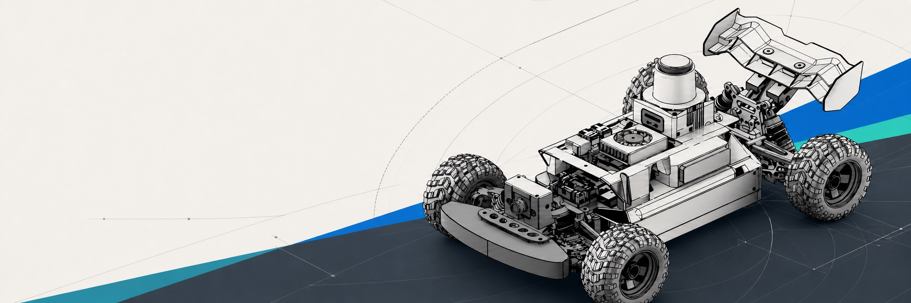

# OSRacer Base

<!-- markdownlint-disable MD013 MD033 -->

<p align="center">
  <a href="./README.md">English</a> ·
  <a href="./README_zh.md">简体中文</a>
</p>

<p align="center">
  
</p>

<p align="center">
  <strong>OSRacer 软件平台的 ROS 2 底盘接口。</strong>
</p>

<p align="center">
  <a href="https://github.com/osrbot/osracer_base/actions/workflows/ros2-ci.yml"></a>
  <a href="https://docs.ros.org/en/humble/"></a>
  <a href="https://docs.ros.org/en/jazzy/"></a>
  <a href="./LICENSE"></a>
</p>

OSRacer Base 为 OSRacer 车辆控制器与上层机器人软件提供可复用的 ROS 2
连接。软件包将底盘串口数据转换为标准 ROS 消息，并接收速度控制和 Ackermann
控制命令。

## 功能特点

- 速度与 Ackermann 控制接口
- 里程计、IMU、遥控器原始通道、磁力计和电池状态发布
- 运动和惯性数据使用统一时间戳
- 自动适配轴距、前进/倒车速度限制、最大转角和电池显示范围
- 可配置 ROS 坐标系、发布选项、话题和协方差
- 命令超时自动停车
- 串口自动重连与连接状态诊断
- 启用运动命令前验证固件接口
- 适合车辆部署的稳定 udev 设备名称
- ROS 2 Humble 与 Jazzy 持续集成

## 最新版本

**OSRacer Base v0.3.0** 是当前 ROS 2 底盘接口版本，主要包括：

- 每次连接时读取并严格校验控制器报告的车辆能力；
- 在允许运动前执行故障关闭式固件接口检查；
- 使用统一时间戳发布同步里程计和惯性数据；
- 在发布 ROS 消息前拒绝非法数值遥测；
- 提供自动停止、串口重连和连接状态诊断；
- 覆盖 ROS 2 Humble 与 Jazzy 的构建和测试。

详见 [v0.3.0 版本说明](https://github.com/osrbot/osracer_base/releases/tag/v0.3.0)。

## 安装

### 作为 OSRacer 的组成部分

完整的 [OSRacer](https://github.com/osrbot/osracer) 工作空间通过
`osracer.repos` 导入兼容的 Base 版本。整车、SLAM、导航和竞速应用建议使用
这种方式。

### 独立工作空间

```bash
mkdir -p ~/osracer_base_ws/src
cd ~/osracer_base_ws/src
git clone https://github.com/osrbot/osracer_base.git

source /opt/ros/humble/setup.bash
rosdep install --from-paths . --ignore-src --rosdistro humble -r -y

cd ~/osracer_base_ws
colcon build --symlink-install
source install/setup.bash
```

Ubuntu 24.04 与 ROS 2 Jazzy 环境应改用 `/opt/ros/jazzy/setup.bash` 和
`--rosdistro jazzy`。

## 设备配置

每台 Linux 系统只需安装一次 udev 规则：

```bash
ros2 run osracer_base install_udev_rules
```

安装后重新连接 USB。如果当前用户刚加入 `dialout` 用户组，请注销后重新登录。

无需启动 ROS 节点即可检查设备：

```bash
ros2 run osracer_base check_device
```

## 启动

直接启动驱动。驱动会在串口握手期间自动读取兼容控制器报告的车辆几何与运行限制：

```bash
ros2 launch osracer_base chassis_driver.launch.py
```

默认串口设备为 `/dev/osrbot_base`。仅在确有需要时修改：

```bash
ros2 launch osracer_base chassis_driver.launch.py \
  port:=/dev/ttyACM0
```

在 RViz 中查看里程计和 TF：

```bash
ros2 launch osracer_base odom_view.launch.py
```

## ROS 接口

### 订阅

| 话题 | 类型 | 用途 |
| --- | --- | --- |
| `/cmd_vel` | `geometry_msgs/msg/Twist` | 线速度与角速度命令 |
| `/ackermann_cmd` | `ackermann_msgs/msg/AckermannDrive` | 速度与转角命令 |

驱动使用最近收到的有效命令。如果两个接口在 `cmd_timeout` 时间内都没有提供有效命令，
驱动将发送停车命令。速度、转角和角速度字段必须是有限数值；包含 NaN 或无穷值的命令
会在映射和限幅前被拒绝。对于当前已通过握手的连接，驱动会立即请求零速、转向回中，
且不会用无效命令刷新有效运动指令的超时计时。正常有限值仍按控制器上报的能力限幅。
串口写入失败或不完整时，驱动会断开连接且不刷新指令超时；重连后须重新完成能力握手。

### 发布

| 话题 | 类型 | 用途 |
| --- | --- | --- |
| `/odom` | `nav_msgs/msg/Odometry` | 底盘里程计 |
| `/imu/data` | `sensor_msgs/msg/Imu` | 姿态、角速度与加速度 |
| `/rc_data` | `std_msgs/msg/Int32MultiArray` | 遥控器原始通道 |
| `/magnetometer_data` | `sensor_msgs/msg/MagneticField` | 磁场测量值 |
| `/battery_state` | `sensor_msgs/msg/BatteryState` | 电池电压与显示电量 |

遥控器、磁力计、电池状态和里程计 TF 可以分别启用或关闭。

## 配置

每次建立串口连接时，驱动都会依次验证 `fw version`、`profile get` 和
`vehicle get` 响应，全部通过后才允许运动。通过验证的能力合同提供轴距、独立的
前进与倒车速度限制、最大转角和电池显示范围。这些值只保存在当前连接的内存中，
重连后会重新读取。

ROS 坐标系、TF 发布、传感器发布、话题、协方差和串口时序仍通过 launch 参数
配置。控制器报告的车辆能力不作为 ROS 参数公开。

常用参数：

| 参数 | 默认值 | 说明 |
| --- | --- | --- |
| `port` | `/dev/osrbot_base` | 底盘串口设备 |
| `baudrate` | `460800` | 串口波特率 |
| `cmd_timeout` | `0.5` | 未收到命令后自动停车的等待时间 |
| `reconnect_interval` | `2.0` | 串口重连间隔，单位为秒 |
| `odom_frame_id` | `odom` | 里程计坐标系 |
| `base_frame_id` | `base_footprint` | 车辆基础坐标系 |
| `imu_frame_id` | `imu_link` | IMU 坐标系 |
| `publish_tf` | `true` | 发布里程计 TF |
| `publish_rc` | `true` | 发布遥控器通道 |
| `publish_mag` | `true` | 发布磁场数据 |
| `publish_battery` | `true` | 发布电池状态 |

电池电压和显示范围由控制器提供。该范围只负责把电压换算为
`sensor_msgs/msg/BatteryState` 中显示的百分比，不会改变电压测量和车辆保护行为。

公开握手与校验规则见
[车辆能力协议](docs/vehicle_capability_contract_zh.md)。

## 控制示例

发布低速速度命令：

```bash
ros2 topic pub --once /cmd_vel geometry_msgs/msg/Twist \
  "{linear: {x: 0.3}, angular: {z: 0.0}}"
```

发布 Ackermann 命令：

```bash
ros2 topic pub --once /ackermann_cmd ackermann_msgs/msg/AckermannDrive \
  "{speed: 0.3, steering_angle: 0.1}"
```

查看电池数据：

```bash
ros2 topic echo /battery_state
```

第一次进行运动测试时，应当将驱动轮悬空，并确保能够随时紧急停止车辆。

## 测试分支：编译、启动与试车

本节用于 `codex/base-safety-road-test` 分支的人工验收。按顺序执行，每一步通过后再继续。
**保持现有 V2.1 固件、PID 和车辆参数不变，不执行刷写、配置保存、恢复或校准。**
这里的速度数值仅为本次短时测试请求，不是车辆配置或产品速度承诺。

### 1. 确认环境与源码

支持 Ubuntu 22.04 + ROS 2 Humble，或 Ubuntu 24.04 + ROS 2 Jazzy。
以下使用 Bash，并假设已有仓库位于 `~/osracer_base_ws/src/osracer_base`。
如果实际位置不同，只修改下面的 `BASE_WS`、`BASE_SRC`；复用已经拉取的仓库，不必重复克隆或移动。
`BASE_WS` 是用于此次编译的工作空间目录，`BASE_SRC` 是仓库目录。

先停止其他底盘驱动、导航、遥控键盘和速度发布程序；关闭占用车辆串口的工具。

```bash
export BASE_WS="$HOME/osracer_base_ws"
export BASE_SRC="$BASE_WS/src/osracer_base"

# Humble 使用这一行；Jazzy 改为 /opt/ros/jazzy/setup.bash
source /opt/ros/humble/setup.bash

cd "$BASE_SRC"
git branch --show-current
git log -1 --format='%H %s'
git status --short
```

分支应为 `codex/base-safety-road-test`，工作区应无未归属修改。
首次安全候选提交为 `e254ff88027b1979d4181d29da7ccbf9d05f7a12`；若之后增加文档提交，
当前 HEAD 可以不同，但应包含该提交：

```bash
git merge-base --is-ancestor e254ff88027b1979d4181d29da7ccbf9d05f7a12 HEAD
```

此命令成功时不输出文字，退出码为 0。若失败，先确认拉取的分支，不继续运动测试。

### 2. 安装主机依赖、编译和测试

以下安装和构建只作用于 ROS 主机，不写车辆配置。
已有 `rosdep`、`colcon` 时可跳过工具安装；ROS 2 本身应已正确安装。

```bash
sudo apt update
sudo apt install python3-rosdep python3-colcon-common-extensions python3-pytest

# 仅首次使用且 rosdep 尚未初始化时执行；已经初始化则跳过
# sudo rosdep init
rosdep update
rosdep install --from-paths "$BASE_SRC" --ignore-src --rosdistro "$ROS_DISTRO" -r -y

cd "$BASE_SRC"
python3 -B -m unittest discover -s test -v

mkdir -p "$BASE_WS"
cd "$BASE_WS"
colcon build --base-paths "$BASE_SRC" --packages-select osracer_base --symlink-install
```

确认构建成功后再执行：

```bash
source "$BASE_WS/install/setup.bash"
colcon test --packages-select osracer_base --event-handlers console_direct+
colcon test-result --verbose

ros2 pkg prefix osracer_base
python3 -c 'import osracer_base.chassis_driver as d; print(d.__file__)'
```

验收要求：主机回归测试通过（首次候选为 85 项），构建和 `colcon test-result` 无失败；
包前缀位于本次工作空间 `install` 下，Python 模块路径指向本次工作空间或其源码目录，
不能仍是另一套旧安装。任何一步失败，先保存输出并排查，不继续启动运动。

### 3. 准备车辆、USB 与权限

- 将车稳固固定，驱动轮悬空，转向机构无遮挡；现场有人持遥控器并能立即断电。
- 遥控器油门回中，使用低速档；CH7 先置于遥控控制位置。不要靠持续手扶车辆约束运动。
- 给车辆正常上电，使用 USB 数据线连接测试主机；保持已有固件和参数。
- 首轮只启动 Base，不同时运行整车导航或其他运动程序。

首次配置该主机的 udev/用户组时执行：

```bash
ros2 run osracer_base install_udev_rules
```

此命令仅安装主机 udev 规则并将用户加入 `dialout`。随后重新插拔 USB；
若刚加入用户组，必须注销并重新登录，再加载 ROS 和工作空间环境。
已有设备规则和串口读写权限时可跳过安装。

```bash
ros2 run osracer_base check_device
ls -l /dev/osrbot_base
id -nG
test -r /dev/osrbot_base && test -w /dev/osrbot_base && echo 'serial permissions OK'
```

设备检查应找到 `/dev/osrbot_base`，最后一条应输出权限正常。
设备缺失、权限不足或固件握手不匹配时先停止排查，**不要为了继续测试而刷固件或修改车辆配置**。

### 4. 启动一份驱动并做静止检查

每个新终端都要重新设置相同的 `BASE_WS`，并加载同一个 ROS 发行版和工作空间：

```bash
export BASE_WS="$HOME/osracer_base_ws"  # 改为实际工作空间
source /opt/ros/humble/setup.bash       # Jazzy 使用对应路径
source "$BASE_WS/install/setup.bash"
```

**终端 A：**启动驱动并保存日志，保持此终端运行。

```bash
mkdir -p "$BASE_WS/artifacts/base-road-test"
ros2 launch osracer_base chassis_driver.launch.py 2>&1 |   tee "$BASE_WS/artifacts/base-road-test/driver-$(date +%Y%m%d-%H%M%S).log"
```

应看到 `Vehicle capability contract accepted` 和 `Connected to chassis`，
并核对固件身份日志为既定 V2.1、协议为 1.1。握手通过只说明协议准入，不能代替物理安全检查。

**终端 B：**检查节点、话题与静止数据。

```bash
ros2 node list
ros2 topic list -t
ros2 topic info /cmd_vel --verbose
ros2 topic info /ackermann_cmd --verbose
ros2 topic echo /battery_state --once
ros2 topic echo /odom --once
ros2 topic echo /imu/data --once
ros2 topic hz /odom
```

频率观察数秒后按 Ctrl+C。应只有一份 Base 节点，两个运动话题在测试发布前没有其他发布者；
里程计、IMU、电池消息持续可读，数据无 NaN/Inf，静止时无意外驱动输出。
若 `echo` 一直等待或没有频率输出，不继续运动测试。

`odom_view.launch.py` **已经包含驱动**，不要和终端 A 同时启动，避免串口被两份驱动竞争。
本次基础试车无需 RViz、导航或额外 TF 示例。

### 5. 悬空低速测试与停止发布停车

先确认上一节正常，再把 CH7 切换到主机控制位置，油门保持回中。
**以下命令会使车轮转动。每条单独执行，确认完全停稳后再执行下一条。**
只在一个终端发布运动命令，不同时发布 `/cmd_vel` 和 `/ackermann_cmd`。

终端 B 先发送零速：

```bash
ros2 topic pub --once /cmd_vel geometry_msgs/msg/Twist   '{linear: {x: 0.0}, angular: {z: 0.0}}'
```

短时前进；命令最多运行 4 秒，也可随时 Ctrl+C 提前结束：

```bash
timeout --signal=INT 4s ros2 topic pub --rate 10 /cmd_vel geometry_msgs/msg/Twist   '{linear: {x: 0.1}, angular: {z: 0.0}}'
```

发布停止后，驱动默认在距最后有效命令超过 0.5 秒时请求停车，另有定时器调度延迟；
这不是机械完全停稳时间的承诺。应观察到停止驱动、车轮减速停下，转向回中。
`timeout` 到期返回非零退出码属预期；若命令始终等待订阅者而未发布，不算运动验收通过。

停稳后测试倒车：

```bash
timeout --signal=INT 4s ros2 topic pub --rate 10 /cmd_vel geometry_msgs/msg/Twist   '{linear: {x: -0.1}, angular: {z: 0.0}}'
```

再次停稳后测试 Ackermann 小转角（转角单位为弧度）：

```bash
timeout --signal=INT 4s ros2 topic pub --rate 10 /ackermann_cmd ackermann_msgs/msg/AckermannDrive   '{speed: 0.1, steering_angle: 0.1}'
```

确认正反方向、转向方向与实际车辆一致，停发布后停车。不要通过修改 PID、trim 或车辆参数修正异常；
记录现象后停止本轮测试。

正常结束或想主动停车时，先结束所有非零发布，再执行：

```bash
ros2 topic pub --once /cmd_vel geometry_msgs/msg/Twist   '{linear: {x: 0.0}, angular: {z: 0.0}}'
```

零速命令依赖 ROS、串口和当前控制源，不能代替现场断电手段。若车辆未按预期停车，
立即使用现场停机/断电手段，停止后续测试。

### 6. 非法输入拒绝检查（仅悬空、已停稳）

停止所有正常运动发布后，分别发送以下单条非法输入：

```bash
ros2 topic pub --once /cmd_vel geometry_msgs/msg/Twist   '{linear: {x: .nan}, angular: {z: 0.0}}'

ros2 topic pub --once /ackermann_cmd ackermann_msgs/msg/AckermannDrive   '{speed: 0.0, steering_angle: .inf}'
```

预期保持停车，驱动继续运行，日志出现 `Invalid motion command rejected; requesting stop`。
警告有节流，连续两次不一定各打印一次；两次间隔超过 5 秒便于逐项观察。
如果 CLI 在消息构造阶段拒绝输入，该次不能记为驱动拒绝验证通过。
本步骤验证静止情况下的输入拒绝，不声称验证了运动中的立即停车距离。

随后可重复一次第 5 节短时低速前进，确认新合法指令可正常工作并超时停车。
无需在实车上人为制造串口短写；此故障已由主机回归覆盖。

### 7. 控制源切换、失联与恢复（仍保持悬空）

每个场景单独执行，先结束上一场景的发布者并确认停稳。

| 场景 | 操作 | 通过标准 |
| --- | --- | --- |
| 遥控优先 | CH7 置遥控，油门回中；执行一次第 5 节短时主机前进 | 主机请求不使车轮转动 |
| 切回主机 | 等上条发布程序退出，再将 CH7 切到主机；先不发布，随后才发新的短时低速命令 | 不重放旧主机命令；新命令才允许运动 |
| 主机发布停止 | 重复第 5 节短时前进并等待发布结束 | 请求超时后停车 |
| Base 退出 | 短时主机低速发布期间在终端 A 按 Ctrl+C | 车辆按控制器失联策略停车；物理确认停稳 |
| USB 断开 | 重新启动并握手后，短时主机低速发布期间拔掉主机 USB 数据线 | 失联后停车；不是仅观察连接灯 |
| USB/驱动恢复 | 等运动发布程序完全退出，再接回 USB 或重新启动 Base，先不发运动 | 重新握手，保持静止；新指令才能恢复运动 |
| 遥控作为当前控制源时失联 | CH7 置遥控，以很小油门让悬空车轮转动，再关闭遥控器 | 失联后停车；重新开遥控前先把油门回中，旧油门不应自行恢复 |

遥控器不是当前控制源时，遥控掉线不等同于有效主机控制必须停车，不能混用验收条件。
恢复后的首条运动仍使用短时小速度，并确认异常状态已解除。

维护互斥仅在已有维护界面明确提供**不写配置的进入/退出方式**时追加验证：
先停稳、停止发布、遥控回中，再进入维护；确认短时主机运动请求被阻止，
等发布者结束后退出维护，确认没有旧命令重放。若无法无写入完成，此项记录“未测”。
不要使用 OTA、配置 apply、恢复或校准作为触发维护状态的替代操作。

### 8. 收尾与反馈

悬空检查全部通过后，如需地面短距离试车，先结束发布并停驱动，将车辆安全放到空旷场地，
再重复静止检查和短时低速前进/停车。不要在地面重复故障注入或提高速度；
地面测试单独记录，不把悬空结果当作地面停车性能结论。

结束时停止所有运动发布，发送零速并确认物理停稳，再 Ctrl+C 退出 Base，按正常流程断电。
保存以下信息供决定是否合并：

- 系统、ROS 发行版、Git 提交、`ros2 pkg prefix osracer_base` 和实际 Python 模块路径；
- 主机单元测试、构建、`colcon test-result --verbose` 结果；
- 启动日志，以及每个场景的通过/失败/未测、车辆实际表现；
- 明确哪些是悬空测试、哪些是地面测试，确认固件和车辆参数未改。

日志留在本机工作空间 `artifacts/base-road-test/`。分享前去除设备标识、内网地址等私人信息，
不要直接提交到公开仓库。完成试车不代表自动合并，合并由维护者另行确认。

## 兼容性

启动和每次重连时，驱动都会在启用数据流之前检查固件接口、可运动的 profile
状态和车辆能力合同。控制器必须支持 Proto 1.1 与 `vehicle get` Contract 1。
不支持该命令的旧固件会保持断开且不会收到运动命令；ROS 节点继续运行，以便
连接兼容控制器或稍后重连。

适配较早的 OSRacer launch 文件时，应使用当前 Base 参数名称：

| 旧 launch 参数 | 当前 Base 参数 |
| --- | --- |
| `port_name` | `port` |
| `baud_rate` | `baudrate` |
| `odom_frame` | `odom_frame_id` |
| `base_frame` | `base_frame_id` |
| `imu_frame` | `imu_frame_id` |
| `cmd_watchdog_timeout_s` | `cmd_timeout` |
| `reconnect_interval_s` | `reconnect_interval` |
| `firmware_version_timeout_s` | `firmware_version_timeout` |
| `link_status_enabled` | `connection_status_enabled` |
| `link_ping_period_s` | `connection_refresh_period` |
| `mag_frame` | `mag_frame_id` |

## 故障处理

| 现象 | 建议处理方式 |
| --- | --- |
| 找不到 `/dev/osrbot_base` | 重新安装 udev 规则、连接 USB，并确认当前用户属于 `dialout` 用户组。 |
| 打开串口时权限不足 | 确认用户组设置，然后注销并重新登录。 |
| 串口被占用 | 停止正在使用底盘设备的其他 ROS 节点或工具。 |
| 驱动报告接口不匹配 | 安装支持 Proto 1.1 和车辆能力 Contract 1 响应的控制器固件。 |
| 命令无法驱动车辆 | 检查连接日志、遥控器优先级、命令话题与超时设置。 |
| 话题没有数据 | 运行 `check_device`，重启驱动并检查话题频率。 |

## 开发

运行软件包测试：

```bash
python3 -m pytest -q test
```

ROS 2 CI 会在 Humble 和 Jazzy 上构建并测试软件包。用户可见的版本变化记录在
[CHANGELOG.md](CHANGELOG.md) 中。

## 支持

- [GitHub Issues](https://github.com/osrbot/osracer_base/issues)
- [OSRacer 文档](https://github.com/osrbot/osracer)
- 技术支持与合作：[winter@osrbot.com](mailto:winter@osrbot.com)

## 作者

- Zhihao ZHANG
- Kit So
- Jintai WANG
- dajianli

## 许可证

OSRacer Base 使用 [MIT License](LICENSE) 开源。
